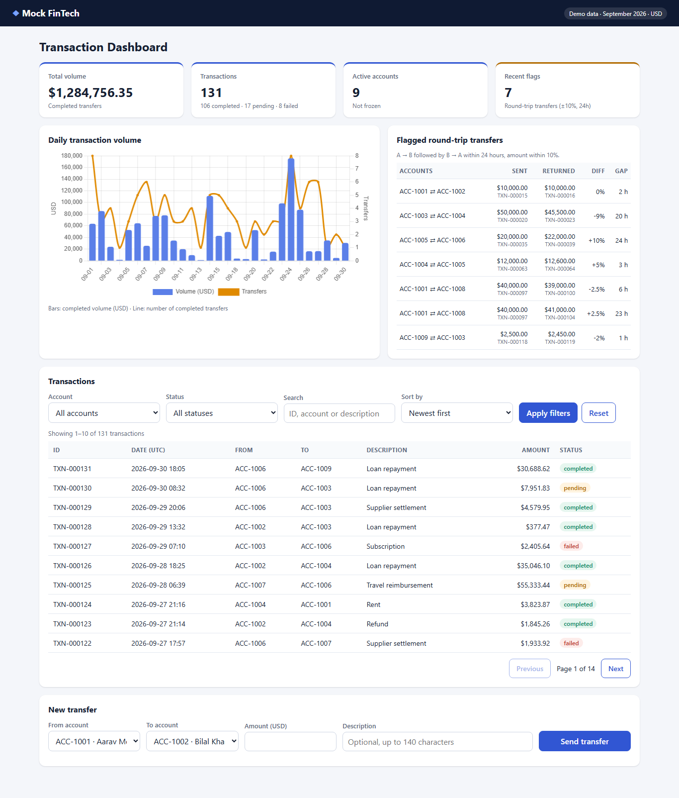
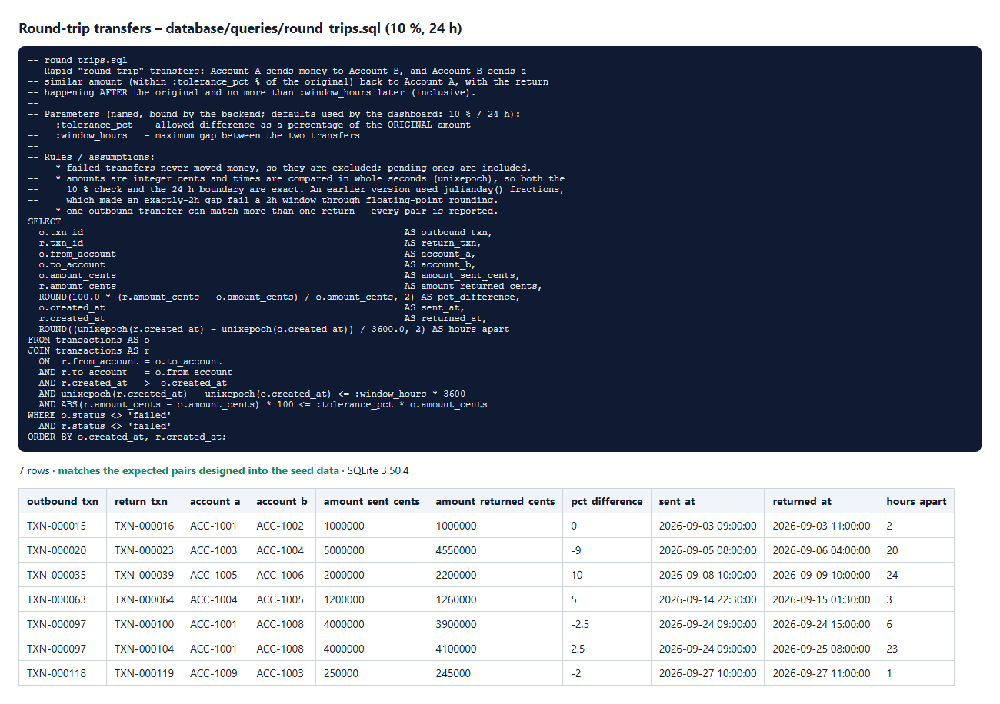

# Mock FinTech Transaction Dashboard

A full-stack demo for monitoring money transfers. It has three parts:

* a **Node.js + Express REST API** backed by **SQLite**;
* a **dashboard** with KPIs, a filterable transaction table, a **Chart.js** trend chart and **round-trip anomaly flags**;
* a **Playwright + Cucumber BDD** automation suite using the Page Object Model, with an **AI self-healing locator** proof of concept.



| Area | Status |
|---|---|
| Backend API | `GET /api/transactions` (pagination, sorting, filtering, search), `POST /api/transfers`, `GET /api/analytics/round-trips`, plus summary, daily-volume and accounts endpoints |
| Frontend | KPI cards, Chart.js volume trend, flagged round-trips panel, filterable, searchable and paginated table, new-transfer form |
| SQL analytics | [`database/queries/round_trips.sql`](database/queries/round_trips.sql), run by the API and shown on the dashboard |
| UI tests | **13 scenarios / 98 steps passed** |
| API tests | **73 scenarios / 392 steps passed** |
| Self-healing | 5 brittle locators, all healed and validated; 5 out of 5 deliberately wrong proposals rejected ([details](tests/self-healing/SELF_HEALING.md)) |
| Evidence | [`results/`](results/): HTML and JSON reports, screenshots, console logs, SQL output |

---

## 1. Setup

**Requirements:** Node.js **22.13 or later** (24 LTS recommended). The project uses Node's built-in `node:sqlite`, so there is no native module to compile and no database server to install.

```bash
npm install
npx playwright install chromium     # browser for the UI tests (one-time)
```

## 2. Run

| Command | What it does |
|---|---|
| `npm start` | Starts the API and dashboard at **http://localhost:4000**. Set `PORT` to change it |
| `npm run test:api` | API suite. Starts its own server on port 4100. Report: `results/api/cucumber-report.html` |
| `npm run test:ui` | UI suite. Starts its own server on port 4100. Report: `results/ui/cucumber-report.html`, screenshots in `results/screenshots/` |
| `npm test` | API suite, then UI suite |
| `npm run test:broken` | Runs the intentionally brittle locators. **Expected to fail** |
| `npm run heal` | Self-healing POC. Uses Claude if `ANTHROPIC_API_KEY` is set, otherwise an offline heuristic. Output: `results/self-healing/` |
| `npm run heal:verify` | Checks that the healer **rejects** 5 deliberately wrong fixes |
| `npm run db:query` | Runs the round-trip SQL on a fresh database, asserts the expected rows, and saves `results/sql/round-trips.{txt,png}` |
| `npm run db:seed` | Regenerates the deterministic seed data |
| `npm run report:summary` | Prints a PASS/FAIL list for each scenario from the JSON reports |

Run a subset by tag, for example: `npx cucumber-js --profile ui --tags @filters`.

Stop `npm start` before running the tests. They use a different port (4100), but stopping it avoids confusion over which server you are looking at.

---

## 3. Architecture

```
backend/                       Express API (CommonJS)
  server.js                    starts the HTTP server (PORT, default 4000)
  app.js                       middleware, /api routes, static frontend, /vendor/chart.js
  routes/index.js              route table (+ test-only POST /api/test/reset when ENABLE_TEST_ROUTES=true)
  controllers/                 thin HTTP layer
  validators/                  query/body validation -> 400 / 422 with field-level details
  services/                    business logic + SQL (transactions, transfers, analytics)
  middleware/errors.js         ApiError + one consistent error format, 404 and 500 handlers
  db/connection.js             node:sqlite; runs /database migrations + seeds at start-up
database/
  migrations/001_create_schema.sql   accounts + transactions (money as INTEGER cents)
  seeds/001_seed_data.sql            generated: 10 accounts, 131 transfers (Sept 2026)
  seeds/expected_round_trips.json    expected anomaly pairs designed into the seed
  queries/round_trips.sql            THE round-trip query, used by the API and by db:query
  tools/generate-seed.js             deterministic seed generator (fixed PRNG seed)
  tools/run-round-trips.js           runs + asserts the query, saves text + PNG output
frontend/                      Vanilla JS (ES modules) + CSS, Chart.js served locally
  index.html, css/styles.css, js/{api,chart,dashboard,format}.js
tests/
  config/config.js, env/*.env  environment config (TEST_ENV=local|staging) – no hard-coded URLs
  features/ui|api|self-healing Gherkin feature files
  step-definitions/            thin glue: call page objects / API clients, assert
  page-objects/                DashboardPage composed of components (KPIs, chart, filters, table, flags, transfer form)
  api/                         API service objects (TransfersApi, TransactionsApi) + payload builders
  support/world.js, hooks.js   Cucumber World, server start, data reset per scenario, screenshots
  utils/oracle.js              independent re-implementation of totals, daily volume and round trips
  self-healing/                brittle page object, healer utility, prompt, runner, SELF_HEALING.md
results/                       committed test evidence
```

**Design decisions**
* **Money is stored as integer cents.** The API exposes decimal dollars, but every calculation, including the round-trip 10% rule, is done in whole cents, so there is no floating-point drift.
* **Deterministic data.** The database is in-memory and rebuilt from `/database` on every start. Tests call `POST /api/test/reset` before each scenario, so they are independent and repeatable. That endpoint only exists when `ENABLE_TEST_ROUTES=true`.
* **One source of truth for the SQL.** The backend reads `database/queries/round_trips.sql` itself, so the query you review is the query that runs.
* **Safe by construction.** Every query is parameterised, sort columns come from a whitelist, `LIKE` wildcards are escaped, and the frontend writes all data with `textContent`. That is why the SQL- and HTML-injection payloads in the API tests are stored and displayed as plain text.

---

## 4. API reference

**Error format (every endpoint):** `{ "error": { "code": "…", "message": "…", "details": [{ "field": "…", "message": "…" }] } }`

| Status | When |
|---|---|
| 200 | Successful GET |
| 201 | Transfer created. The body is `{ data: transaction }`, and a `Location` header is set |
| 400 | Malformed JSON, a body that isn't an object, missing required fields, or invalid or unknown query parameters |
| 404 | Unknown `/api` route |
| 413 | Body larger than 16 KB |
| 415 | `POST /api/transfers` without `Content-Type: application/json` |
| 422 | Well-formed request that breaks a rule: bad format, amount out of range, description too long or containing control characters, same account on both sides, unknown or frozen account, insufficient funds, unknown field |
| 500 | Unexpected error. It is logged on the server, and a generic message is returned with no internals leaked |

### `GET /api/transactions`
| Param | Values | Default |
|---|---|---|
| `page` | integer ≥ 1 | 1 |
| `pageSize` | 1–100 | 10 |
| `sortBy` | `date` \| `amount` | `date` |
| `order` | `asc` \| `desc` | `desc` |
| `account` | `ACC-1234`, matching sender **or** receiver | – |
| `status` | `completed` \| `pending` \| `failed` | – |
| `search` | ≤ 100 chars; matches transaction ID, accounts or description | – |

Unknown or repeated parameters return **400**. Response: `{ data, pagination: { page, pageSize, totalItems, totalPages }, sort, filters }`.

### `POST /api/transfers`
```json
{ "fromAccount": "ACC-1001", "toAccount": "ACC-1002", "amount": 125.50, "description": "optional, ≤ 140 chars" }
```
Rules:
* Accounts must match `ACC-` followed by 4 ASCII digits, must exist, must be active and must be different from each other.
* The amount must be a JSON number above 0 and no more than 1,000,000, with at most 2 decimal places.
* The description is at most 140 *characters* (Unicode code points, so emoji count as one) and must contain no control characters.
* Unknown fields are rejected.

The transfer is atomic: both balances are updated and the transaction is inserted in one SQL transaction.

### `GET /api/analytics/round-trips?windowHours=24&tolerancePct=10`
Returns `{ criteria, count, accountsInvolved, data: [{ outboundTxn, returnTxn, accountA, accountB, amountSent, amountReturned, pctDifference, sentAt, returnedAt, hoursApart }] }`. The limits are `windowHours` 1–168 and `tolerancePct` 0–50.

### Supporting endpoints
`GET /api/summary` · `GET /api/analytics/daily-volume` · `GET /api/accounts` · `GET /api/health`

---

## 5. SQL analytics: round-trip transfers

> *Find instances where Account A sends money to Account B, and Account B sends a similar amount (within 10%) back to Account A, both within a 24-hour window.*

[`database/queries/round_trips.sql`](database/queries/round_trips.sql) self-joins `transactions` with these conditions:
* `r.from = o.to` and `r.to = o.from`;
* the return happens strictly after the original and at most 24 h later, compared in **whole seconds** with `unixepoch`;
* `|r − o| × 100 ≤ 10 × o`, in integer cents, so the comparison is exact.

Failed transfers are excluded, because no money moved; pending ones count. One outbound transfer can match several returns, and every pair is reported.

The seed data contains one test case per rule:

| Case | Expected |
|---|---|
| Exact amount back after 2 h | flagged |
| 9% lower back after 20 h | flagged |
| **Exactly +10% and exactly 24 h** (both boundaries) | flagged |
| Crosses midnight, +5% after 3 h | flagged |
| 15% lower | not flagged |
| 24 h **+ 1 minute** | not flagged |
| Return transfer **failed** | not flagged |
| Money moves on to a third account | not flagged |
| One outbound, two returns in the window | 2 pairs |
| Pending return, −2% | flagged |

`npm run db:query` asserts that the output is exactly these pairs. The API tests then compare the endpoint with an **independent JavaScript implementation** ([`tests/utils/oracle.js`](tests/utils/oracle.js)) at the default and custom criteria. The dashboard shows the result in the *Flagged round-trip transfers* panel and marks the flagged rows in the table.



---

## 6. Test automation

**Framework rules followed**
* Gherkin features, then thin step definitions, then page objects and API service objects.
* All URLs come from `tests/config/env/<TEST_ENV>.env`. `local` starts the server itself; `staging` points at a deployed URL.
* Locators use `getByRole` with accessible names, `getByLabel` and `getByTestId`. There are no positional CSS or XPath selectors outside the intentional `tests/self-healing/BrittleDashboardPage.js`.
* Assertions are web-first (`expect` from `@playwright/test`), so there are no fixed sleeps.
* **Independent oracles.** Expected values (totals, daily volumes, filter counts, round trips) are calculated in the test code from the raw API data and never by calling the app's own logic.

**Feature 1: UI** ([`dashboard.feature`](tests/features/ui/dashboard.feature), 13 scenarios)
* The KPI cards match totals calculated independently.
* The chart is checked through the live Chart.js instance: one point per day, every value finite and non-negative with at least one above zero, values equal to the independent daily totals, and the bars adding up to the Total volume card.
* Filtering by status (×3) and by account, combined filters with sort by amount, search by ID, the empty-state message, pagination, and the flags panel matching the independent detection.
* A transfer sent from the UI updates the table and the KPIs; a rejected transfer shows its error.

**Feature 2: API** ([`transfers.feature`](tests/features/api/transfers.feature), [`transactions.feature`](tests/features/api/transactions.feature), 73 scenarios)

| Group | Cases |
|---|---|
| Missing required fields → 400 | each field, all fields, `{}`, empty string, `null`; details name exactly the missing fields |
| Not a JSON object → 400 / 415 | malformed JSON, array, string, `null`, form-encoded body |
| **Excessive string lengths** | description of 1 and 140 characters → 201; 141 and 5,000 → 422; 20,000 → **413**; 140 emoji → 201 (characters, not bytes); 5,000-character account ID → 422 |
| **Special characters** | emoji, multi-language text, SQL injection, HTML/script injection, quotes and backslashes, zero-width/RTL marks, `%`/`_` → 201 and stored exactly, with the table intact afterwards. Null byte, newline, tab and bell → 422. Injection, lower-case, full-width digits and numeric values in account IDs → 422 |
| Amount boundaries | 0.01 and 1,000,000 → 201; 1,000,000.01, 0, −5, 0.001, `1e309` (Infinity), `"100"` and `true` → 422 |
| Business rules → 422 | same account, unknown account, frozen sender or receiver, insufficient funds (nothing recorded), unknown field |
| Transactions and round trips | pagination, sorting (date and amount, both directions), filters checked against independent counts, 10 invalid-parameter cases, round trips equal to the independent oracle at 3 criteria, and invalid criteria |

**Proving the tests can fail.** I deliberately broke the app four times and checked that the suites went red each time, then restored the code:

| Bug introduced | Result |
|---|---|
| `<` instead of `<=` in the 10% rule | 3 API + 2 UI scenarios failed |
| Description limit raised to 200 | 1 API scenario failed |
| Total volume KPI off by 0.1% | 2 UI scenarios failed |
| Account filter matching only the sender | 1 API + 1 UI scenario failed |

---

## 7. Results ([`results/`](results/))

| Suite | Result | Evidence |
|---|---|---|
| API | 73/73 scenarios, 392/392 steps | `results/api/cucumber-report.html`, `results/console/api-scenarios.txt` |
| UI | 13/13 scenarios, 98/98 steps | `results/ui/cucumber-report.html`, `results/screenshots/`, `results/console/ui-scenarios.txt` |
| Brittle locators | fails as intended at the first broken locator | `results/broken/`, `results/screenshots/FAILED-*.png` |
| Self-healing | 5/5 healed and validated; 5/5 wrong proposals rejected | `results/self-healing/healing-report.md`, `suggested-fixes.patch`, `results/console/heal-verify.log` |
| SQL | 7 pairs, matching the designed cases | `results/sql/round-trips.txt`, `round-trips.png` |

The HTML reports embed a screenshot and the request/response details for each scenario.

---

## 8. AI pair-programming reflection

**How AI was used.** I wrote a detailed specification: the tech stack, the folder layout, the endpoints and status codes, the SQL scenario, the two test features and the self-healing POC. I then used Claude to scaffold and implement the project and to work through it with me. That covered the API layer and validation rules, the seed-data design, the Page Object structure, the Cucumber steps and the healer utility. I used it to explain parts that were new to me, such as `node:sqlite`, reading data back from a live Chart.js instance, and ARIA-based locators. I then ran everything on my own machine and reviewed the results.

**What worked well**
* Scaffolding the whole structure was fast and consistent across backend, frontend and tests.
* **Independent checks caught real bugs, some of them in the AI's own code:**
  * **A floating-point bug in the SQL.** The first version of the round-trip query compared `julianday()` fractions. The test for a custom 2-hour window failed because a transfer exactly 2 hours later was treated as *outside* the window (0.0833… days is not exact in binary). The query now compares whole seconds with `unixepoch()`. The default 24-hour case hid this, because 1.0 day is exact.
  * **An accessibility/locator bug.** Fields wrapped inside `<label>` elements gave the `<select>`s an accessible name that included their option text, so `getByLabel('Status', { exact: true })` found nothing. Switching to explicit `<label for>` fixed both the tests and screen-reader output.
  * **A parsing bug.** Two badges with no space between them made the status cell read `completedFlagged`. Adding a space fixed the DOM text, and the parser now reads the status with a pattern.
  * **A layout bug.** The full-page screenshot showed the flags table pushing the page wider than the screen. Functional assertions wouldn't catch that.
* **Mutation testing** (Section 6) showed that the suites fail when the app is wrong, not only that they pass when it's right.
* **Validating the self-healer.** The first behaviour check for the Apply button ("clicking reloads the table") would also have accepted the *Reset* button. It now requires the request to carry the chosen filter, and `npm run heal:verify` proves that wrong proposals are rejected.

**What didn't work, or needed correcting**
* AI-written code was confidently wrong several times (the four bugs above). It was the independent oracles, the mutation tests and the screenshots that caught them, not a code review.
* `require.resolve('chart.js/dist/…')` failed because of the package's `exports` map, so the file is now resolved from the package's main entry.
* Version drift: Playwright 1.64 had just been released and would have required a new browser download. The versions are pinned to 1.63.0 to match the installed browser.
* The AI's first behaviour checks were too weak to tell similar elements apart. I treat any AI-generated "validation" as something that itself needs a negative test.

**My takeaway.** AI made building this much faster. The parts that made it *trustworthy* were the independent expected values, the boundary-focused seed data, and tests that are proven able to fail.
